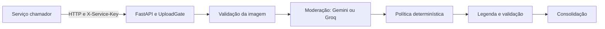
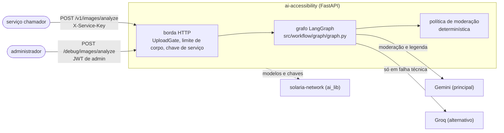
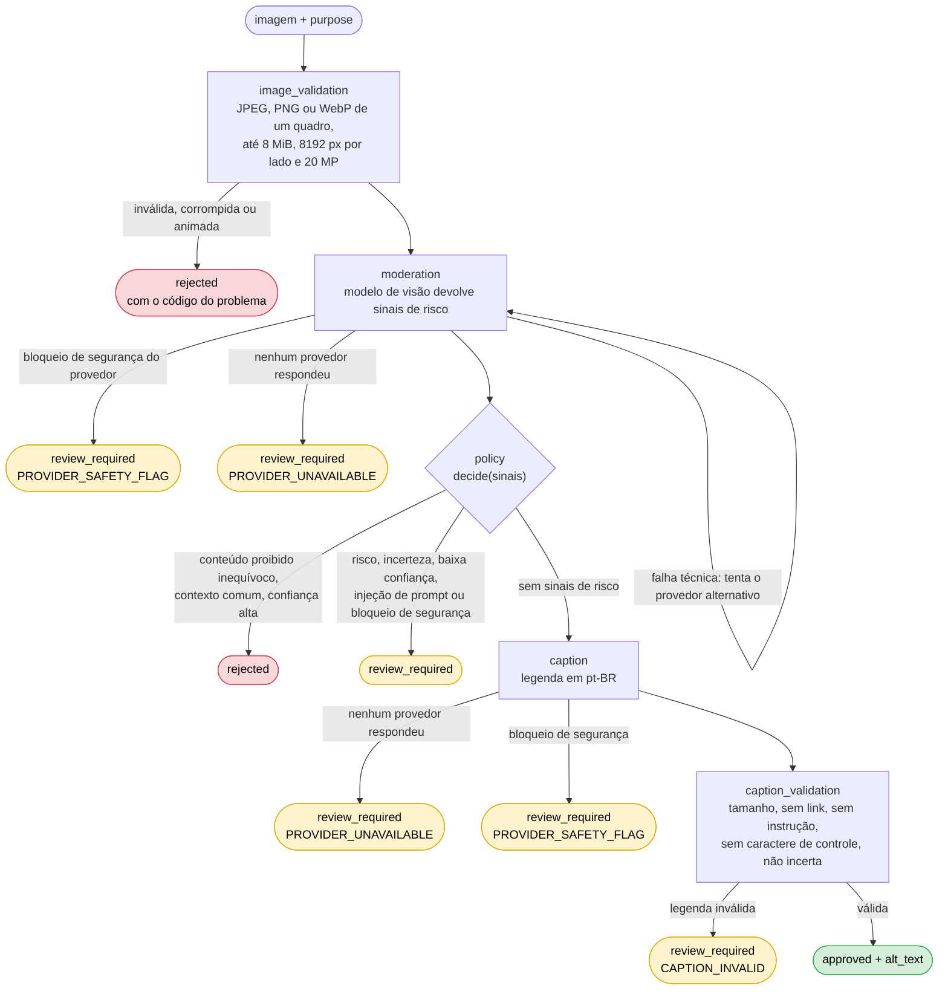

  

# Arquitetura

A API FastAPI conduz um grafo LangGraph que separa validação de arquivo, sinais de visão, política determinística e validação da legenda, com os modelos e as chaves da biblioteca compartilhada `solaria-network` (`ai_lib`). A fonte da decisão está em [policy.py](https://github.com/Solierrr/ai-accessibility/blob/main/src/moderation/policy.py).

| Pasta | Papel |
|---|---|
| `src/api/` | Rotas, autorização, limite bruto e erros |
| `src/image/` | Decodificação e normalização |
| `src/moderation/` | Sinais e política de decisão |
| `src/core/` | Configurações, modelos e chaves (`ai_lib.llm`), segurança e observabilidade |
| `src/agents/` | Agente de visão LangChain e prompts de cada especialista |
| `src/workflow/` | Grafo LangGraph (nós, rotas, estado), rastreio e reexecução do debug |
| `src/services/` | Contrato da resposta e invocação do grafo |

O arquivo é autenticado antes do parser multipart na rota principal. A normalização remove metadados, aplica orientação e aceita somente JPEG, PNG e WebP de um quadro. O limite é oito MiB, vinte milhões de pixels e 8192 pixels por lado.

Os provedores seguem `LLM_PROVIDER_ORDER` (padrão Gemini, depois Groq), entre os que têm chave, com rodízio de chaves pela `ai_lib`. O segundo provedor atua como alternativa para falhas técnicas, mas nunca para contornar um bloqueio de segurança do provedor. O processamento simultâneo é limitado por um semáforo configurável, o `/health` informa a versão lida de `version.txt` e o `/ready` confere se há provedor configurado, sem fazer chamada remota.

Não há banco próprio. O debug guarda imagens temporariamente em memória para replay, com expiração de quinze minutos, limite de dez execuções por administrador e orçamento global de 64 MiB. Os dados somem em reinício. A integração entre serviços está no [mapa central](https://github.com/Solierrr/docs-warehouse/blob/main/docs/flows/INTEGRATIONS.md).

## Diagramas

### Onde o serviço se encaixa

O serviço recebe imagens de um serviço chamador, com a chave de serviço dele, e de administradores pela rota de debug, com JWT de admin. Os modelos de visão são o Gemini e, só em falha técnica, o Groq, na ordem de `LLM_PROVIDER_ORDER`.

### Grafo de uma análise

Cada análise é independente: o grafo não usa checkpointer e nada é guardado. Quando uma etapa fecha o desfecho (rejeição ou revisão), o grafo desvia direto para a consolidação.

Todo desfecho passa pela etapa `consolidation`, que só mantém o `alt_text` quando a imagem foi aprovada. Uma imagem com incerteza, sinais de risco ou bloqueio de segurança do provedor nunca é aprovada, e o bloqueio de segurança não é contornado pelo provedor alternativo.
